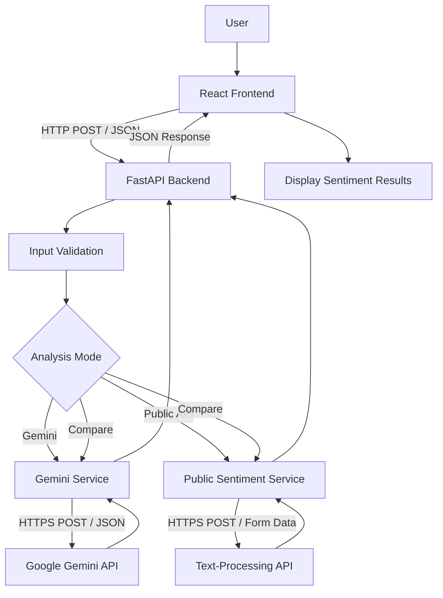

# AI Sentiment Analyzer — Architecture

## System Architecture

This is a logical communication diagram for local development. It describes service responsibilities and request flow, not a production deployment topology.

## Components

### Frontend

React and TypeScript provide the dashboard. Users enter text, choose Gemini, Public API, or Compare mode, and view provider results. Tailwind CSS supplies the responsive visual design.

### FastAPI backend

The backend is the central REST gateway. It validates input with Pydantic, exposes documented endpoints, selects provider services through routes, maps provider failures to HTTP errors, and returns normalized JSON to the frontend.

### Gemini service

`app/services/gemini_service.py` sends a JSON request to Gemini using the backend-only `x-goog-api-key` header. Its response is parsed and validated as `SentimentResult`.

### Public sentiment service

`app/services/public_sentiment_service.py` sends form-encoded text to Text-Processing.com and maps its `pos`, `neg`, and `neutral` labels into the application's public result format. This provider is intended primarily for English comparison text.

## SOA principles demonstrated

- Services have separate responsibilities and interfaces.
- The frontend depends on the FastAPI gateway, not directly on external providers.
- Provider implementations are isolated behind service classes.
- Schemas define the JSON contracts between layers.
- Provider errors are translated at the REST boundary.
- Compare mode can display one provider's result even when the other provider fails.

## Request flow

1. React sends the user's text as JSON to FastAPI.
2. FastAPI validates and routes the request.
3. The selected provider service calls its external REST API.
4. The provider response is validated or normalized.
5. FastAPI returns JSON to React.
6. React renders sentiment, confidence, explanations, keywords, or probabilities.
